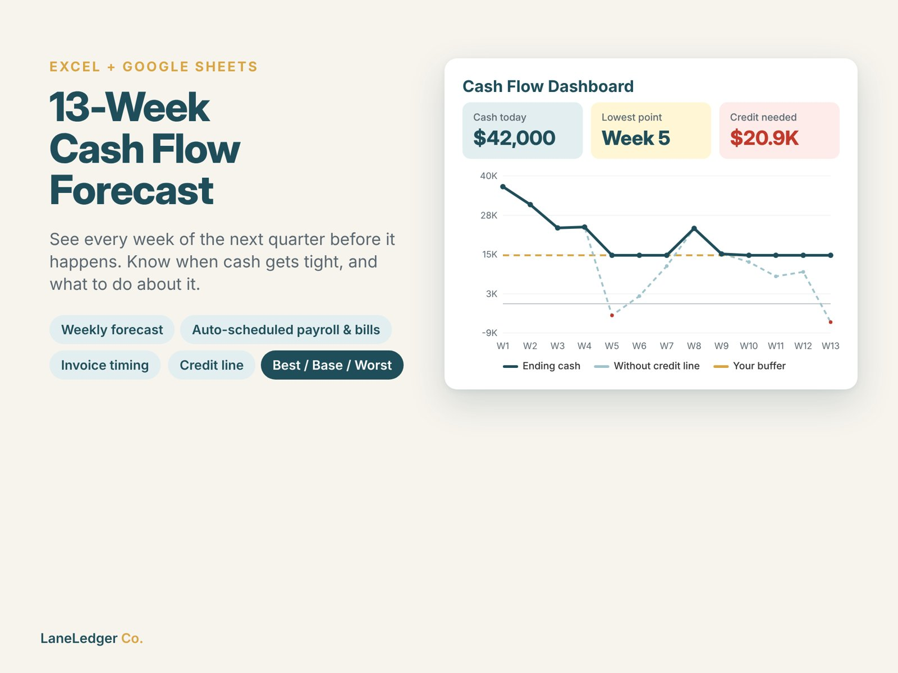
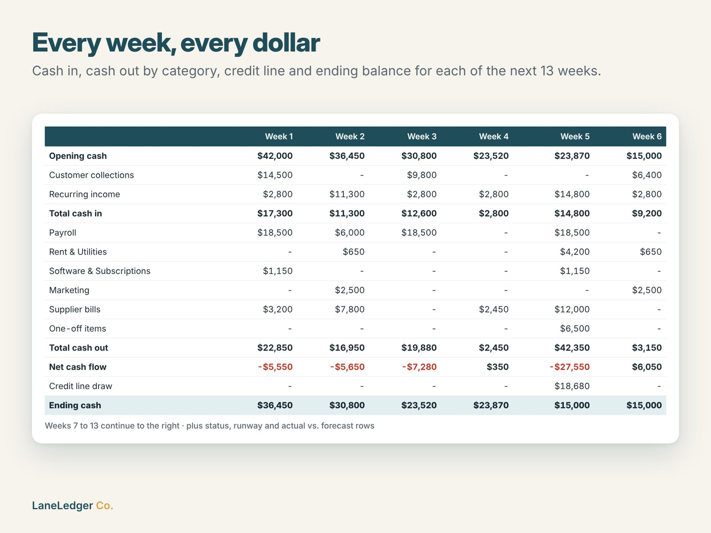
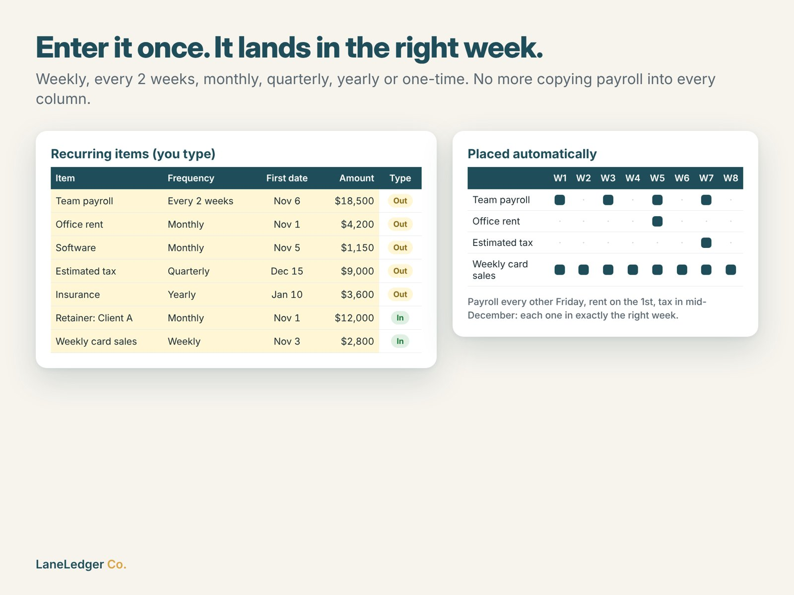
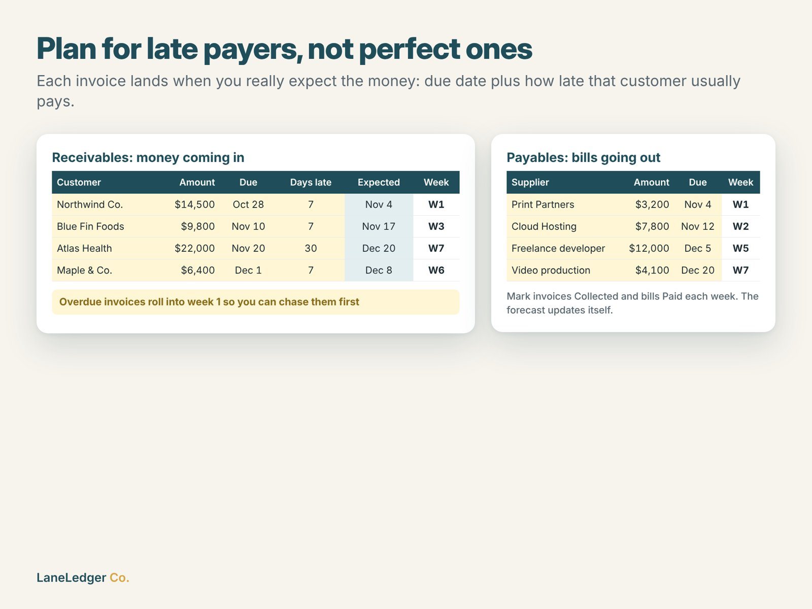
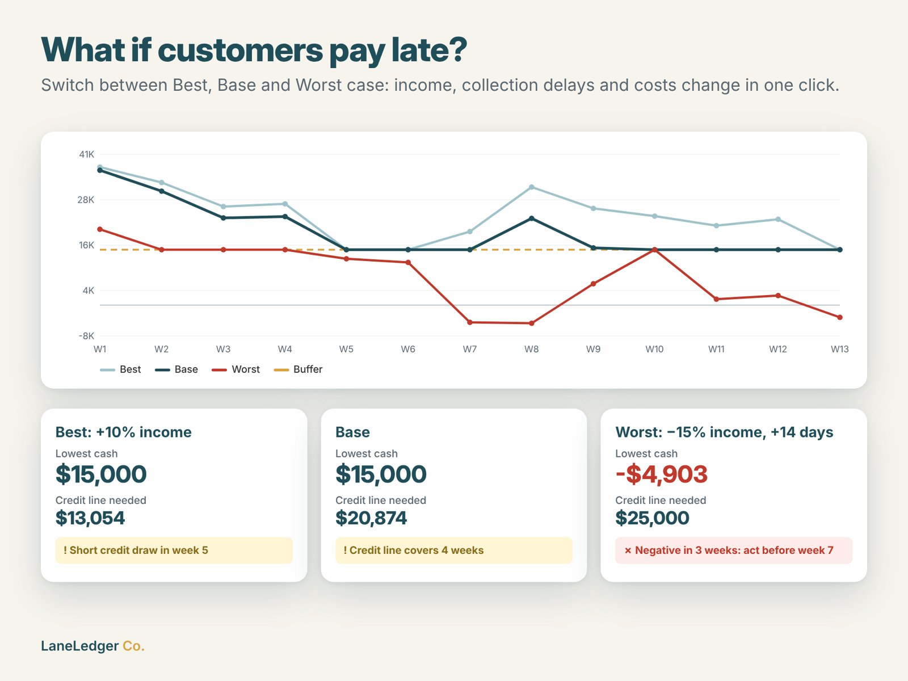
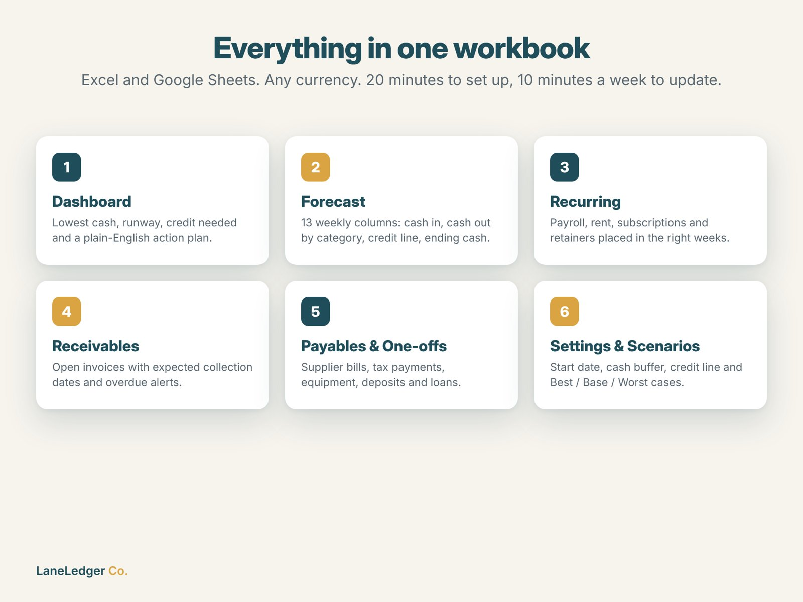

# 13-Week Cash Flow Forecast

An 8-tab Excel / Google Sheets workbook that shows a small business its cash balance for each of the next 13 weeks: when cash dips below the safety buffer, how much of a credit line it would need, and how long the runway is.

**[View on Etsy](https://www.etsy.com/listing/4603380202/cash-flow-forecast-template-13-week)** · **[Download the free 4-week demo](demo/Cash_Flow_4_Week_Preview_FREE_DEMO.xlsx?raw=1)** · Part of [LaneLedger Co.](https://github.com/EkremHakanSevil/laneledger-spreadsheet-tools)

🎬 **[Watch the 13-second product video](video/product_video.mp4)**

## Features

- **Recurring engine:** enter an item once (weekly, every 2 weeks, monthly, quarterly, yearly or one-time, with an optional end date) and every occurrence lands in the right week automatically.
- **Receivables with late payers:** each invoice is collected on its due date plus how late that customer usually pays. Overdue invoices roll into week 1.
- **Payables and One-off Items:** supplier bills, tax payments, equipment, loans received, deposits and bonuses.
- **Credit line:** draws automatically to keep cash at the buffer, repays when cash recovers, and estimates weekly interest.
- **Scenarios:** Best / Base / Worst case with income, collection delay and expense multipliers, switched in one click.
- **Dashboard:** cash today, ending cash, lowest point and its week, weeks below buffer, credit needed, runway without credit, two charts and a plain-English action plan.
- **Actual vs. forecast:** enter the real ending cash each week and track the variance.

| Weekly forecast | Recurring items | Receivables |
|---|---|---|
|  |  |  |

| Scenarios | What's included |
|---|---|
|  |  |

## 🎁 Free demo

[`Cash_Flow_4_Week_Preview_FREE_DEMO.xlsx`](demo/Cash_Flow_4_Week_Preview_FREE_DEMO.xlsx?raw=1) is a working 4-week forecast. It includes the recurring engine, receivables with late-payer delays, payables, one-off items, the credit line and the scenarios. Open it in Excel, or import it into Google Sheets (File → Import → Upload).

The [full version](https://www.etsy.com/listing/4603380202/cash-flow-forecast-template-13-week) adds:
- the full 13-week horizon with totals
- the Dashboard and action plan
- actual vs. forecast tracking
- up to 60 rows on every input tab

## How it was built

| Area | Details |
|---|---|
| Problem research | Cash flow is one of the most common reasons small businesses get into trouble, and the 13-week forecast is the standard format that turnaround advisors and lenders use. Spreadsheet versions on Etsy are mostly simple monthly budgets. |
| Generation | Python + `openpyxl`: the workbook is generated from code, with styling, dropdown validation, conditional formatting, 2 charts and ~1,250 formulas. |
| Scheduling logic | A closed-form occurrence counter (weekly / bi-weekly / monthly / quarterly / yearly, with month-end handling and end dates), written with Excel-2007-compatible functions (`CHOOSE`, `MATCH`, `SUMIFS`, `INT`). It was checked against an independent Python implementation with 0 mismatches. |
| Testing | Headless LibreOffice recalculation (zero formula errors), plus hand-checked Base / Best / Worst scenarios for ending cash, credit draws and the runway. |
| Images & video | HTML/CSS templates rendered to 2000×1500 listing images with Playwright, and an ffmpeg slideshow video. |

**AI-assisted:** Built in collaboration with Anthropic's Claude. I chose the problem, pricing and branding, reviewed and tested the product and ran the Etsy listing. Claude helped with research, code generation, design and copywriting. The Etsy listing discloses AI use, as Etsy's Creativity Standards require.

---
*This repo contains screenshots, documentation and a free demo only. The full workbook is sold on Etsy.*
